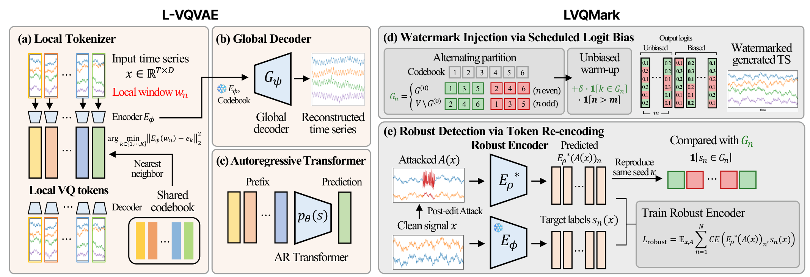
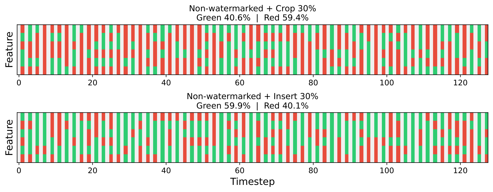
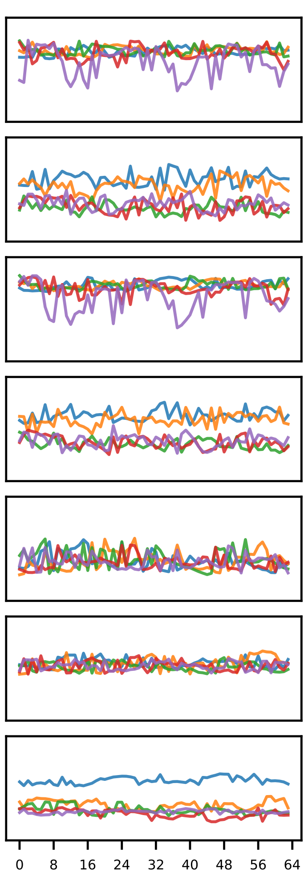
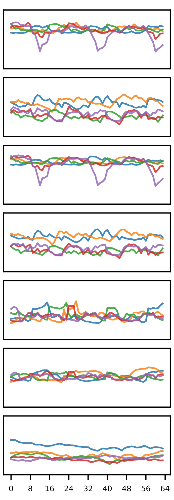
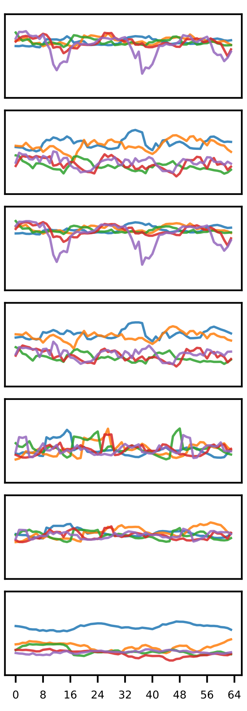
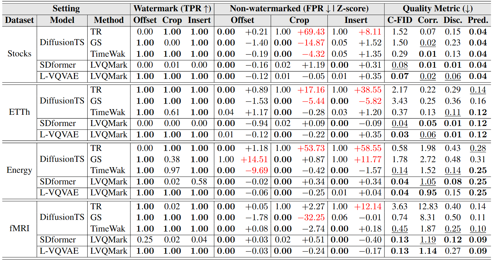

# LVQMark (NeurIPS 2026)

#### This repository is an official PyTorch implementation of L-VQVAE and LVQMark: [A Locally Tokenized Generative Model for Robust Time-Series Watermarking](https://openreview.net/forum?id=j0GmuP3V69) [[Project Page](https://dongbeank.github.io/LVQMark)]

## Key Design of LVQMark



#### ⚡ Re-encoding stability as the root of false-positive reliability

Time-series watermark detectors must first re-encode a continuous signal into discrete units before running the green-ratio test. When this re-encoding map is globally coupled, a post-editing attack (offset, crop, insert) shifts the null distribution of the detection statistic on *non-watermarked* samples in either direction, so a threshold calibrated on clean negatives no longer controls the false-positive rate.

#### ⚡ L-VQVAE: a locally tokenized generative model

L-VQVAE encodes each short sliding window into a single codebook entry with a windowed cross-attention tokenizer, so a temporal edit can change at most the few tokens whose windows it overlaps. Locality is imposed only on the encoder; a global cross-attention decoder and an autoregressive transformer over the shared codebook model long-range structure and generate the series.

#### ⚡ LVQMark: scheduled logit bias + robust re-encoding

LVQMark embeds a red–green logit bias during autoregressive sampling with a context-independent partition that alternates with token-position parity and an unbiased warm-up over the first positions. At detection time a robust encoder, trained on attacked samples to recover the clean token assignments, replaces the clean encoder in the green-ratio z-score test.



## Watermarking Results

Original and L-VQVAE-generated ETTh samples (length 64), with and without the LVQMark watermark:

<p>
  
  
  
</p>

Watermark detection (TPR on watermarked samples; FPR and mean z-score on attacked non-watermarked samples) under 30% attacks, together with generation quality at length 64 (best in bold, second best underlined):



## Getting Started

### Requirements

Python 3.10, PyTorch 2.10 (CUDA 12.8), TensorFlow 2.12 (used only by the discriminative and predictive metrics).

```bash
pip install -r requirements.txt
```

### Data Preparation

All four datasets (ETTh, Energy, Stocks, fMRI) are included in `Data/datasets/`.

### Training

```bash
# all four datasets
bash scripts/run_train.sh
GPU=1 WINDOW=24 bash scripts/run_train.sh

# one dataset, 4 stages: pretrain -> decoder -> AR transformer -> robust encoder
python -u cli/train.py --config_file configs/lvqvae/etth.yaml \
    --dataset etth --window_size 64 --gpu 0
# one stage only: --stage 4
```

### Generation and Detection

```bash
bash scripts/run_generate.sh            # clean + watermarked samples, then detect
bash scripts/run_generate.sh stocks

# generate, without and with the watermark
python -u cli/generate.py --config_file configs/lvqvae/etth.yaml \
    --dataset etth --window_size 64 --gpu 0 --watermark_delta 10
python -u cli/generate.py --config_file configs/lvqvae/etth.yaml \
    --dataset etth --window_size 64 --gpu 0 --watermark --watermark_delta 10

# detect: the clean condition + 6 attacks, on watermarked and non-watermarked samples
python -u cli/generate.py --config_file configs/lvqvae/etth.yaml \
    --dataset etth --window_size 64 --gpu 0 --watermark_delta 10 --detect_all
# score the same samples under a different key (the wrong-key control): --detect_key 999
```

The watermark has two switches, both on by default: `--alternating_partition` flips the green
set with token-position parity, and `--unbiased_warmup` leaves the first `--warmup_positions`
token positions without a logit bias (default `min(4, token_length // 3)`).

### Evaluation

```bash
bash scripts/run_evaluate.sh            # quality metrics + watermark z-score
MODE=zscore bash scripts/run_evaluate.sh etth energy

# --mode full | quick | zscore
python -u cli/evaluate.py --config_file configs/lvqvae/etth.yaml \
    --dataset etth --window 64 --delta 10 --mode full --deterministic
```

Seeds: `--seed` everywhere (default 12345), plus `--watermark_seed` for the green-list key.
`--deterministic` turns on `cudnn.deterministic`, which the quality metrics need to repeat on
GPU. `--gpu N` selects the CUDA device; the scripts export `CUDA_DEVICE_ORDER=PCI_BUS_ID` so
that `N` matches the index `nvidia-smi` reports.

The baseline generators used in the paper (`GENERATOR=diffusionts` or `GENERATOR=sdformer`)
run end to end with `bash scripts/run_baselines.sh`, or through `cli/train_baselines.py`,
`cli/generate_baselines.py` and `cli/evaluate_baselines.py` with `--generator`.

### Layout

```
cli/            train.py generate.py evaluate.py + the *_baselines.py twins
scripts/        run_train.sh run_generate.sh run_evaluate.sh run_baselines.sh
configs/        per-dataset YAML, one directory per generator
Models/         local_vqvae, transformer_ar, interpretable_diffusion/, sdformer/, ts2vec/
Utils/          io_utils, path_utils, greenlist, watermark_utils, metrics
Data/           build_dataloader.py + datasets/
docs/           project page
```

Artifacts are created on first run under `checkpoints/`, `outputs/` and `results/`, keyed by
the config and the seeds (see `Utils/path_utils.py`). Generation and detection skip work that
is already on disk; delete an artifact to recompute it.

## Citation
If you find this repo useful for your research, please cite our paper:
```bibtex
@inproceedings{kim2026locally,
  title={A Locally Tokenized Generative Model for Robust Time-Series Watermarking},
  author={Kim, Dongbin and Shin, Geonwoo and Choi, Yujin and Park, Soyeon and Lee, Jaewook},
  booktitle={Advances in Neural Information Processing Systems},
  volume={39},
  year={2026}
}
```

## Acknowledgements
We would like to express our appreciation for the following GitHub repositories, which provided valuable code bases:

- [TimeWak](https://github.com/soizhiwen/TimeWak)
- [Diffusion-TS](https://github.com/Y-debug-sys/Diffusion-TS)
- [TS2Vec](https://github.com/zhihanyue/ts2vec)
- [TimeGAN](https://github.com/jsyoon0823/TimeGAN)

Datasets: [ETDataset](https://github.com/zhouhaoyi/ETDataset),
[UCI Appliances Energy Prediction](https://archive.ics.uci.edu/dataset/374/appliances+energy+prediction),
[TimeGAN stock data](https://github.com/jsyoon0823/TimeGAN),
[FMRIB NetSim](https://www.fmrib.ox.ac.uk/datasets/netsim/).

## Contact
If you have any questions or want to use the code, please contact dongbin413@snu.ac.kr
